  

<h3 align="center">Software Engineer | Backend & Full-Stack</h3>

<strong>Building reliable systems, from APIs and data pipelines to applications people use.</strong>

  
  
  
  

I'm a software engineer based in **Nairobi, Kenya**, working across backend services, full-stack applications, cloud infrastructure, and mobile platforms. I enjoy solving the difficult parts of software delivery: reliable integrations, offline-first experiences, data consistency, and systems that remain maintainable as they grow.

My work includes products reaching **100,000+ users**, wearable and biometric data integrations, agricultural advisory platforms, and independently built fintech tools. I also enjoy mentoring developers, writing about engineering, and experimenting with Go and hardware projects.

### 🛠️ Tech Arsenal

  
<b>☁️ Backend & Data Engineering</b>

   
  
  
  
  
  
  
  
  
  

  
<b>📱 Mobile & Frontend Engineering</b>

   
  
  
  
  
  
  
  

  
<b>⚙️ DevOps, Architecture & Leadership</b>

   
  
  
  
  
  
  
  

 

### 🚀 Selected engineering work

#### [Pesa Radar](https://play.google.com/store/apps/details?id=com.sable.pesa_radar) · Independent project
**Offline-first fintech · Flutter · Hive · Firestore**

An Android personal-finance app that turns transaction SMS into useful financial insights while keeping SMS processing on-device. Built with layered architecture, local-first storage, optional cloud synchronization, and a structured SMS parsing engine. Implemented chunked backup and restore flows with integrity checks.

#### SmartRunning · Professional work
**Wearable integrations · Flutter · FastAPI · GCP**

Contributed to a running and training platform that connects athlete profiles, activity history, training plans, and wearable providers. Built mobile experiences and backend integrations, worked with provider-specific synchronization challenges, and supported data processing and app-store delivery. My work spans Flutter/BLoC, FastAPI services, and cloud data pipelines.

#### FarmBetter · Professional work
**Agri-tech · Flutter · Angular · GraphQL · Firebase**

Worked on an agricultural advisory platform reaching **100,000+ farmers across 10+ countries**. Helped deliver mobile and web experiences designed for practical use in diverse, often connectivity-constrained environments.

#### MyBlueprint / Hoplit · Professional work
**Personal development · Flutter · Firebase**

Contributed to a cross-platform habit, goal, and roadmap application available on iOS and Android, with **30,000+ users**. Worked on mobile features, product improvements, and release delivery.

**More experiments:** [GitHub repositories](https://github.com/Frankline-Sable?tab=repositories) · [Engineering portfolio](https://frankline-sablegithubio.vercel.app/)

### 💼 Experience

- **Senior Full-Stack Engineer — ITalanta / Elewa** · Jan 2022–Present  
  Building mobile and backend features, integrating external services, supporting production delivery, and mentoring engineers across product teams.
- **Full-Stack Engineer — Savanna Dot Net** · Sep 2021–Jan 2022  
  Developed web and Android applications, including fintech and blockchain-related functionality.
- **Full-Stack Engineer — Techxers Kenya Ltd** · Jan 2020–Aug 2021  
  Delivered client web and mobile projects and mentored junior developers.
- **Co-Founder & Lead Developer — Creators Galaxy Inc** · Nov 2019–2022  
  Developed game systems and tooling using Unity, C#, and SQLite.

### 📈 GitHub activity

  

### ✍️ Beyond the code

I write about engineering decisions, architecture, practical lessons, and things I've learned while building software. You can find my writing and projects through my [portfolio](https://frankline-sablegithubio.vercel.app/).

When I'm not coding, I'm usually exploring a new tool, tinkering with hardware, or playing *Civilization* or *Age of Empires*. 🐎

  <a href="https://www.linkedin.com/in/frankline-sable/">LinkedIn</a> ·
  <a href="https://frankline-sablegithubio.vercel.app/">Portfolio</a> ·
  <a href="https://github.com/Frankline-Sable">GitHub</a>

